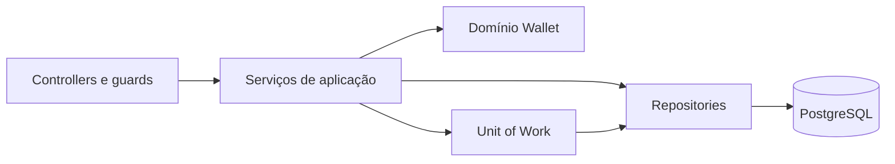

# Arquitetura

Este documento descreve a arquitetura **implementada**.

## Visão geral

A aplicação é um monólito modular: API NestJS, PostgreSQL e transações síncronas.
Não usa microserviços, broker ou projeções assíncronas.

## Módulos

| Módulo         | Responsabilidade                                                      |
| -------------- | --------------------------------------------------------------------- |
| `registration` | Cria usuário, carteira e evento inicial em uma transação.             |
| `auth`         | Hash de senha com Argon2id, JWT, sessões persistidas e logout.        |
| `users`        | Persistência e busca de usuários.                                     |
| `wallet`       | Regras de saldo, projeção, consulta e replay/verificação da carteira. |
| `events`       | Validação de sequência e persistência de eventos de carteira.         |
| `database`     | Schema Drizzle, conexão, Unit of Work e ferramenta interna de seed.   |
| `common`       | Erros de domínio e tradução para respostas HTTP.                      |

## Dados e consistência

- `users` e `sessions` representam identidade e sessões revogáveis.
- `wallets` guarda uma projeção síncrona de saldo e versão, com uma carteira no
  máximo por usuário e constraint de saldo não negativo.
- `events` guarda o histórico append-only **por convenção da aplicação**; cada
  carteira tem versões sequenciais. Os valores são centavos inteiros (`bigint`),
  serializados como strings no JSON.
- `transfers` e `idempotency_keys` existem no schema como preparação, mas ainda
  não são usados por casos de uso.

O domínio `Wallet` aplica regras monetárias sem depender de NestJS ou Drizzle.
Repositories encapsulam consultas. O Unit of Work compartilha uma transação Drizzle
entre escritas relacionadas. Ao persistir uma alteração, a projeção é atualizada
com comparação de versão; eventos e projeção devem ser gravados na mesma transação.

O replay e `WalletConsistencyVerifier` comparam o saldo/versão da projeção com o
histórico de uma carteira. A verificação é interna e não repara dados. Ela não
reconcilia operações entre carteiras nem garante conservação global de fundos.

## Fluxos disponíveis

- `POST /users`: cadastra usuário e carteira de saldo zero atomicamente.
- `POST /auth/login` e `POST /auth/logout`: emitem e revogam sessão.
- `GET /wallets`: retorna a carteira do usuário autenticado.
- CLI `db:seed-wallet`: adiciona fundos de desenvolvimento por referência
  idempotente; não é integração de depósito.

O guard valida JWT e sessão persistida em cada chamada autenticada. A validação
global de DTOs rejeita campos não declarados. Erros conhecidos recebem respostas
controladas; detalhes do banco não são enviados ao cliente.

## Limites arquiteturais

Serviços de aplicação dependem de NestJS, repositories concretos e do tipo de
transação Drizzle. A interface Unit of Work coordena transações, mas não abstrai
outros bancos. O domínio da carteira é independente; a aplicação inteira não é.

Embora o código de eventos use alguns nomes genéricos, hoje ele suporta apenas
agregados `WALLET`. Não há framework genérico de event sourcing. O desenho atual
é intencionalmente síncrono e adequado ao escopo implementado.

## Referências

- [README: execução, endpoints e testes](../README.md)
- [Schema Drizzle](../src/database/drizzle.schema.ts)
