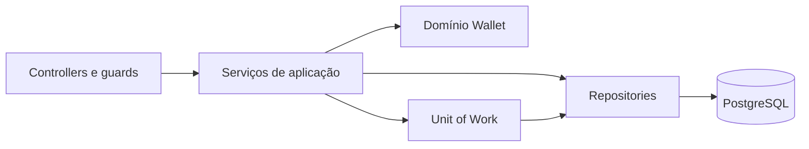

# Arquitetura

Este documento descreve a arquitetura **implementada**.

## Visão geral

A aplicação é um monólito modular: API NestJS, PostgreSQL e transações síncronas.
Não usa microserviços, broker ou projeções assíncronas.

## Módulos

| Módulo         | Responsabilidade                                                      |
| -------------- | --------------------------------------------------------------------- |
| `registration` | Cria usuário, carteira e evento inicial em uma transação.             |
| `auth`         | Hash de senha com Argon2id, JWT, sessões persistidas e logout.        |
| `users`        | Persistência e busca de usuários.                                     |
| `wallet`       | Regras de saldo, projeção, consulta e replay/verificação da carteira. |
| `transfers`    | Transferências e estornos transacionais, autorização e idempotência.  |
| `events`       | Validação de sequência e persistência de eventos de carteira.         |
| `database`     | Schema Drizzle, conexão, Unit of Work e ferramenta interna de seed.   |
| `common`       | Logging de requisições, erros de domínio e respostas HTTP.             |

## Dados e consistência

- `users` e `sessions` representam identidade e sessões revogáveis.
- `wallets` guarda uma projeção síncrona de saldo e versão, com uma carteira no
  máximo por usuário e constraint de saldo não negativo.
- `events` guarda o histórico append-only **por convenção da aplicação**. A
  aplicação valida versões sequenciais por carteira; o banco garante versões
  positivas e únicas, mas não impede lacunas por si só. Valores monetários são
  centavos inteiros (`bigint`), serializados como strings no JSON.
- `transfers` registra transferências e compensações. `reversal_of` vincula um
  estorno à operação original e é único, impedindo duas compensações para ela.
- `idempotency_keys` reserva comandos por usuário e chave, com fingerprint do
  pedido. Reserva, operação, saldos e eventos são confirmados na mesma transação.

O domínio `Wallet` aplica regras monetárias sem depender de NestJS ou Drizzle.
Repositories encapsulam consultas de domínio. O endpoint de prontidão é uma
exceção simples e consulta o banco diretamente.

O Unit of Work compartilha uma transação Drizzle entre escritas relacionadas.

Ao persistir uma alteração, a projeção é atualizada com comparação de versão.
Eventos e projeção devem ser gravados na mesma transação.

`TransfersService` mantém as regras específicas em `create` e `reverse`. A reserva
ou recuperação da idempotência é compartilhada por `resolveIdempotency`, e
`moveFunds` concentra locks, débito, crédito e criação da operação. Ambos usam
`WalletService.persistChanges` para gravar projeção e eventos, recebendo a transação
do comando, sem abrir transações aninhadas.

Transferências e estornos bloqueiam as carteiras com `FOR UPDATE`, em ordem de ID,
antes de calcular os novos saldos. Essa ordem reduz o risco de deadlocks entre
movimentações em sentidos opostos.

A comparação de versão também protege escritores otimistas, como o seed, e mantém
a sequência dos eventos alinhada à projeção.

No estorno, a transferência original é bloqueada antes da validação de elegibilidade.
Esse lock serializa solicitações com chaves diferentes; a chave de idempotência
protege repetições do mesmo comando. A constraint única em `reversal_of` é a
garantia adicional de no máximo uma compensação por transferência.

O replay e `WalletConsistencyVerifier` comparam o saldo/versão da projeção com o
histórico de uma carteira. A verificação é interna e não repara dados. Ela não
reconcilia operações entre carteiras nem garante conservação global de fundos.

## Fluxos disponíveis

- `POST /users`: cadastra usuário e carteira de saldo zero atomicamente.
- `POST /auth/login` e `POST /auth/logout`: emitem e revogam sessão.
- `GET /wallets`: retorna a carteira do usuário autenticado.
- `GET /wallets/history`: consulta operações em `transfers`, não o stream de eventos.
- `POST /transfers`: transfere centavos do usuário autenticado para outro usuário.
- `POST /transfers/:id/reverse`: compensa integralmente uma transferência própria.
- `GET /health/live` e `GET /health/ready`: verificam a aplicação e o acesso ao
  banco de dados, respectivamente.
- CLI `db:seed-wallet`: adiciona fundos de desenvolvimento por referência
  idempotente; não é integração de depósito.

Uma falha antes do commit desfaz todas as escritas por rollback. Após o commit, o
estorno é uma nova operação no sentido inverso, autorizada somente ao remetente
original. Não há estorno parcial nem de outro estorno. Se o destinatário não tiver
saldo suficiente, a solicitação falha sem efeitos parciais.

Os eventos originais nunca são alterados. O status do registro da transferência
original muda para `REVERSED` na mesma transação que cria a compensação.
Isso não viola a imutabilidade do histórico de eventos da carteira.

Uma retentativa com a mesma chave e comando normalizado reproduz a resposta de
criação, mesmo se a operação já tiver sido estornada. Por isso essa resposta mantém
`COMPLETED`, enquanto o histórico retorna o status atual `REVERSED`. Reutilizar a
chave para outro comando, inclusive entre criação e estorno, retorna conflito.

O guard valida JWT e sessão persistida em cada chamada autenticada. A validação
global de DTOs rejeita campos não declarados. Erros conhecidos recebem respostas
controladas; detalhes do banco não são enviados ao cliente. `configureApp`, em
`src/app.setup.ts`, aplica o filtro de erros, o pipe de validação e o middleware
de logging no bootstrap da API.

## Limites arquiteturais

Serviços de aplicação dependem de NestJS, repositories concretos e do tipo de
transação Drizzle. A interface Unit of Work coordena transações, mas não abstrai
outros bancos. O domínio da carteira é independente; a aplicação inteira não é.

Embora o código de eventos use alguns nomes genéricos, hoje ele suporta apenas
agregados `WALLET`. Não há framework genérico de event sourcing. O desenho atual
é intencionalmente síncrono e adequado ao escopo implementado.

## Referências

- [README: execução, endpoints e testes](../README.md)
- [Schema Drizzle](../src/database/drizzle.schema.ts)
